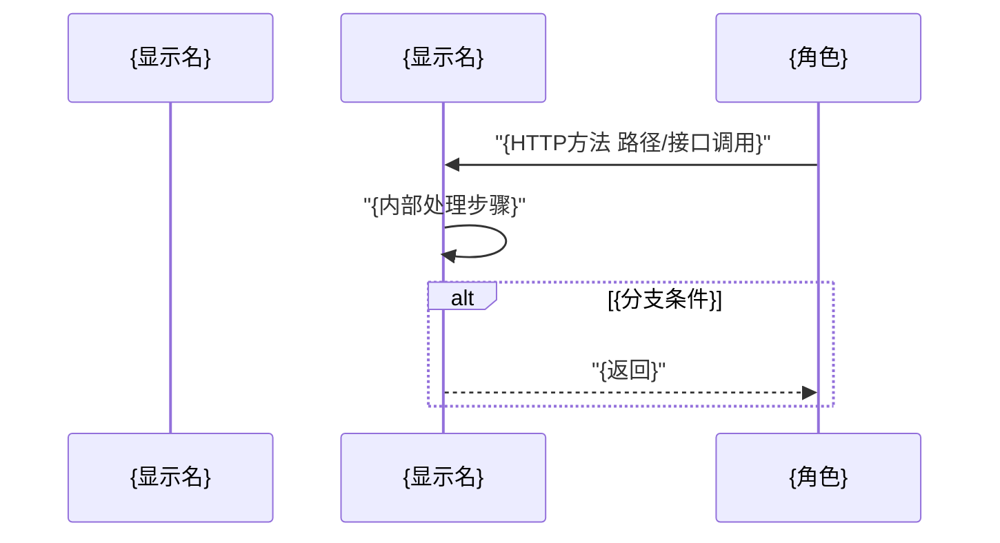
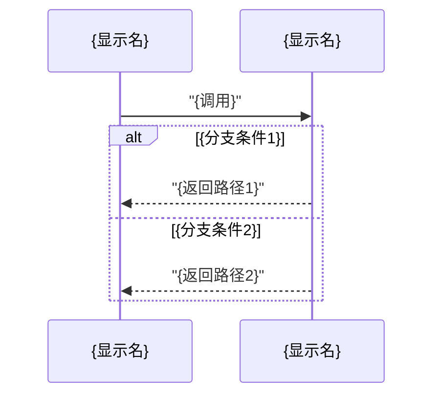

# {功能名} Story

> 
> 需求概述：{一句话说清做什么功能、给谁用、解决什么问题}
> 来源：{需求文档相对路径}（下称"需求"）　分支：{分支名}（{YYYY-MM-DD}）

> 
> **基线说明**（如有 stub/历史回退等情形时写，否则省略本段）：本次"变更前"基线为 {当前存量现状描述——精确到哪些函数是 stub（返回 not implemented）、哪些已完整实现、哪些常量/错误哨兵/锁已就绪、DAO/DDL/controller handler/route 是否已就绪、单测覆盖情况}，增量（delta）= {从基线到目标的具体变更内容}。

## 1. 澄清（功能澄清决策 Q&A）

需求与存量代码比对后，已与用户确认以下决策点：

| 编号 | 疑问描述 | 澄清结论 | 依据 |
| --- | --- | --- | --- |
| Q1 | {需求未明确或与存量代码有差异的点，一句话说清问题} | {做了什么决定，为什么这么选} | {需求章节/存量代码位置/历史裁定} |

表后用粗体行汇总返回码或关键口径总则（如有多个决策点涉及返回码/边界值等统一口径）：

**{口径总则名}**：{关键返回码/端口/常量等口径汇总}。

无疑问时本节直接写"无"。

## 2. 需求概述 → 映射到模块角度

### 2.1 功能分析

从模块角度进行功能设计。先看模块间交互时序图（基于顶层架构资产 [structure-model/README](../../0-arch/structure-model/README.md) 模块定位与依赖方向 + [interaction-model/README](../../0-arch/interaction-model/README.md) {相关流程}，参考交互模型资产梳理；participant 为 Go 包粒度），从模块间交互关系分解功能：

模块间交互关系梳理（承接上图，逐条列模块间的接口调用，供 §3 各模块内部接口表承接）：

| 发起模块 | 接口调用 | 目标模块 | 在本链路中的用途 |
| --- | --- | --- | --- |
| {发起方包名} | {接口名/调用描述} | {目标方包名} | {在本链路中干什么} |

> 本图即基于代码刷新资产中交互模型的成果，实施后需 spec-update 补齐缺失的交互模型文档（`interaction-model-{flow}.md`，见 §6.3）。

### 2.2 功能清单（按模块维度）

承载功能设计中拆解到本服务的功能清单（基于架构资产 [structure-model/README](../../0-arch/structure-model/README.md) 模块定位与模块间关系）。链路从外部入口沿 {controllers → service → dao → models} 单向流动：

**术语表**：

| 术语 | 解释 | 出处 |
| --- | --- | --- |
| {术语名} | {人话解释} | {需求章节/代码文件} |

| # | 功能 | 承载模块（包粒度） | 变更类型 | 一句话职责 |
| --- | --- | --- | --- | --- |
| F1 | {功能名} | {包名} | **新增**/**变更**/**复用** | {一句话} |

变更类型取值：**新增**（本需求引入的全新模块/函数）/ **变更**（对既有模块的修改）/ **复用**（全量复用既有实现，零代码修改）。

## 3. 模块设计

每个参与模块各开一节（{controllers / service / dao / models} 等，按依赖方向排序），每节四小节。**复用模块**的 3.x.4 功能点修改清单改为复核项表，**变更模块**才有推导表四件套（功能描述+功能点拆分+代码修改方案推导表+判定列）。

### 3.{x} {模块名} 模块设计

#### 3.{x}.1 接口（外部接口/内部接口）

**外部接口**（服务对外提供的 HTTP 接口，单独呈现）：

| 接口 | 路径/方法 | 请求结构 | 响应结构 | 变更状态 |
| --- | --- | --- | --- | --- |
| {接口名} | `{方法} {路径}`；路由注册 `{文件}` | {请求格式描述} | {响应格式描述} | **新增**/**变更**/**复用**：{说明} |

**内部接口**（模块间接口，承接 §2.1 模块间交互关系）：

| 接口 | 调用方 → 提供方 | 签名/入口 | 变更状态 |
| --- | --- | --- | --- |
| {接口名} | {调用方} → {提供方} | `{Go签名}` | **新增**/**变更**/**复用**：{说明} |

> 无外部接口的模块（如 service/dao/models）省略外部接口表，只列内部接口表；无内部接口的纯数据模块（如 models）注明"无内部接口，静态结构见 §3.x.2"。

#### 3.{x}.2 数据模型 / 对象模型

本次 {模块名} 模块须参考/变更的对象与数据类（一句话说清"在 xxx 场景用 xx 对象，实现 xxx 功能"）：

| 对象/数据类 | 变更状态 | 一句话说明 |
| --- | --- | --- |
| {类名} | **新增**/**变更**/**复用** | 在{场景}用{类名}（{特征}），实现{功能} |

> 无数据模型/对象模型变更的模块注明"无"。

#### 3.{x}.3 交互模型（模块内）

{模块名} 模块内实现时序图（participant 为包粒度，{模块自交互承载什么}，出站到 {下游模块}）：

> 时序图只画模块内实现的编排与分支，每个分支体现一条返回路径，不画外部链路（外部链路见 §2.1）。participant 必须用 Go 包名（如 controllers/service/dao 等），不用"导入服务""HTTP 入口"等模糊称呼，外部调用方用业务角色名。纯数据结构模块（如 models/db）直接写模块特征（如"为静态数据结构定义，无交互逻辑"），不加"不画时序图"前缀。

#### 3.{x}.4 功能点修改清单

---

**复用模块格式**（全量复用既有实现，零代码修改时使用）：

**变更：无（全量复用）**

本模块零代码修改。{既有实现状态说明——精确到函数级：哪些函数已完整实现、签名是什么、单测覆盖情况}。复核项：

| # | 复核点 | 结论 |
| --- | --- | --- |
| 1 | {复核点：如"xxx 函数签名是否兼容调用方期望"} | 是/否——{一句话依据} |

---

**变更模块格式**（有代码修改时使用，每个变更点一组）：

**变更 {n}：{变更标题}**

**功能描述**：在 <业务场景> 时，实现 <行为变更>（依据 <需求章节/裁定> [Q{编号}]）。<行为变更用业务语言，禁止代码符号——函数名/变量名/类名/方法调用/常量名/错误码变量名不得出现在描述正文中。>

**功能点拆分**：

| # | 功能点 |
| --- | --- |
| 1 | <一句话业务描述，人能读懂，不出现文件名/函数名/代码符号> |
| 2 | <同上> |

**代码修改方案推导**：

> 
> 公式：功能点 + 定位文档（改哪里）+ 修改指导文档（怎么改）→ 代码修改
> 定位文档=docs/0-arch/interaction-model/ 下真实存在的交互模型文档；修改指导文档=docs/0-tech/ 下真实存在的技术栈文档。
> 定位列缺 arch 交互模型时填`（缺失，见 §6.3）`；修改指导列无对应 tech 文档时填`（无对应资产文档）`；属于语言基础能力不需文档时填`（语言基础能力，无需文档）`。禁止臆造文档名或内容。

| 功能点 | 定位文档（改哪里） | 修改指导文档（怎么改） | → 代码修改 | 判定 |
| --- | --- | --- | --- | --- |
| #<编号> <功能点一句话描述> | {arch文档路径} 或 `（缺失，见 §6.3）` | {tech文档路径} 或 `（无对应资产文档）` 或 `（语言基础能力，无需文档）` | `{文件路径}:{函数名} {具体改法}` | 待判读 |

> 
> 判定列由 spec-point-verify 独立判读子代理回填（通过/需修订/打回设计），设计阶段留空占位「待判读」。
> 禁止在本文档写打分/评级/综合评分/四维度打分表——判定结论只保留在推导表判定列。
> **功能点列必须带描述**——写 `#1 新增IMSI字段`，不写裸 `#1`；描述取自上方功能点拆分表的一句话，读者看推导表不用回翻。

---

（变更模块有多个变更点时，按变更 1 / 变更 2 / … 逐组展开，每组含功能描述 + 功能点拆分 + 代码修改方案推导表。）

## 4. 关键测试用例

只测对外接口（HTTP/RPC 等入口）的输入输出是否符合预期，按需给出足够覆盖主路径与异常分支的用例，不限制数量。

| # | 用例名 | 输入 | 期望输出 | 覆盖点 |
| --- | --- | --- | --- | --- |
| 1 | {用例名} | {HTTP方法+路径+请求体} | {HTTP状态码+响应体关键字段} | {覆盖变更n的哪些功能点} |
| 2 | {用例名} | {输入} | {期望输出} | {覆盖点} |

禁止写 DT 单测清单、集成测试步骤、验证命令清单（那些归编码工作流提示或主代理执行环节，不进 story.md）。

## 5. 外部文档引用

本设计参考的仓内资产，逐类一行；链接必须指向仓内真实存在的文件，无死链；某类确无引用须注明"无引用"及原因，禁止整节省略：

| 文档类型 | 引用文档 | 引用点 |
| --- | --- | --- |
| 接口文档 | [{文件名}](../../0-biz/interface/{文件名}) | {引用了什么} |
| 数据模型文档 | [{文件名}](../../0-biz/data-model/{文件名}) | {引用了什么} |
| 并发规范文档 | [{文件名}](../../0-tech/concurrency-guidelines/{文件名}) | {引用了什么} |
| 数据访问规范文档 | [{文件名}](../../0-tech/data-access-guidelines/{文件名}) | {引用了什么} |
| 基础框架文档 | [{文件名}](../../0-tech/framework-guidelines/{文件名}) | {引用了什么} |
| 结构模型文档 | [{文件名}](../../0-arch/structure-model/{文件名}) | {引用了什么} |
| 交互模型文档 | [{文件名}](../../0-arch/interaction-model/{文件名}) | {引用了什么} |
| 对象模型文档 | [{文件名}](../../0-biz/object-model/{文件名}) | {引用了什么} |
| 业务知识文档 | [{文件名}](../../0-biz/knowledge/{文件名}) | {引用了什么} |
| 外部服务调用文档 | {无引用或文件链接} | {引用原因或"本需求无新增出向调用"} |
| 既有 story | {无引用或文件链接} | {引用原因或"本需求即首篇"} |

## 6. 需关注事项与资产缺口

### 6.1 判读结果

功能点总数 {N}，全部通过。

| 功能点 | 判定 | 一句话理由 |
| --- | --- | --- |
| {变更n#n} {功能点名} | 通过 | {理由} |

### 6.2 资产缺口

- `{资产文件路径}` 缺失（{原因}），{如何处理}。
- {既有资产表述失实情况}，实施后需 spec-update 刷新。

### 6.3 实现偏差

specgo 第 4 步代码后判定详情回填本节。无偏差时写"无偏差"。

- {无偏差或偏差描述}。
